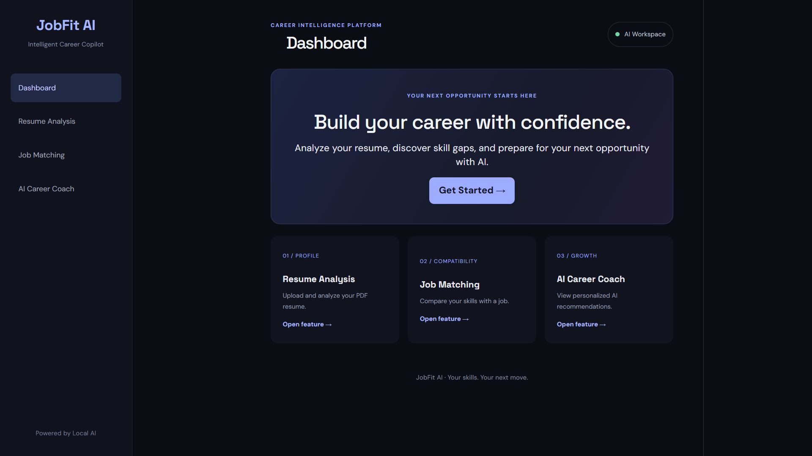
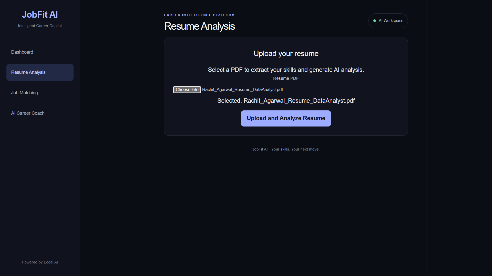
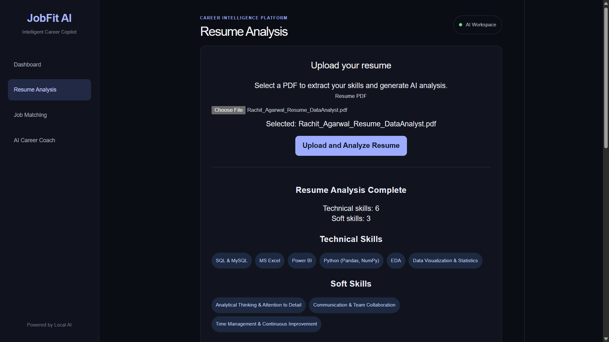
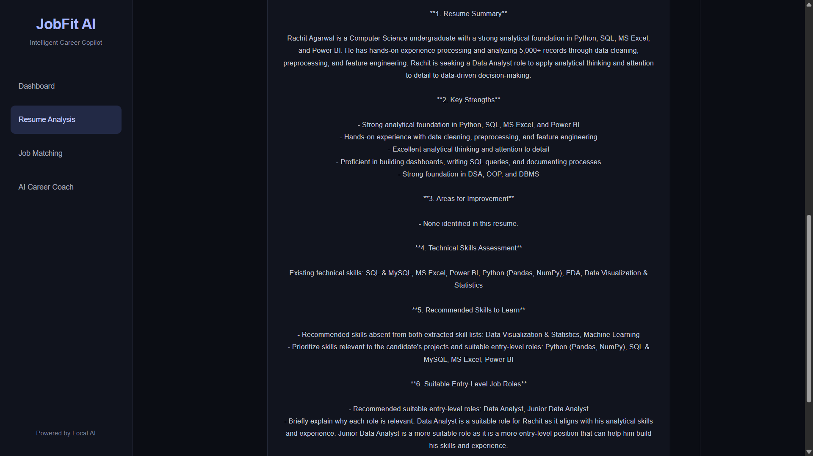
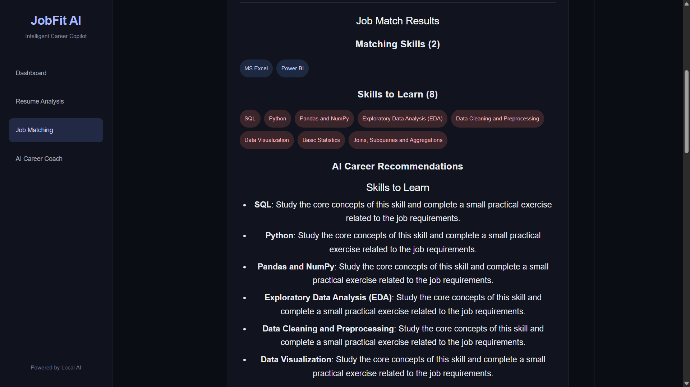

# JobFit AI – Intelligent Career Copilot

JobFit AI is an AI-powered career assistance platform designed to help jobseekers understand their resume strengths, evaluate compatibility with job descriptions, and identify missing skills.

The platform leverages Llama 3.2 (1B) through Ollama to analyze resume content and generate context-aware insights using AI-powered processing and Retrieval-Augmented Generation (RAG).

Built using Java, Spring Boot, React.js, and MySQL, JobFit AI aims to make the job application process smarter, more efficient, and data-driven.


## ✨ Key Features

- **Resume Upload & Analysis:** Upload PDF resumes and extract relevant information, including technical skills, soft skills, projects, education, and experience.

- **AI-Powered Resume Analysis:** Leverage Llama 3.2 (1B) to understand resume content and generate meaningful insights.

- **Job Description Matching:** Compare resume skills against specific job requirements to evaluate job compatibility.

- **Skill Gap Identification:** Identify matching and missing skills based on the provided job description.

- **Improvement Suggestions:** Generate actionable recommendations to help candidates improve their job readiness.

- **RAG-Based Context Retrieval:** Retrieve relevant information from stored document data to provide context-aware AI responses.


## 🛠️ Technology Stack

### Frontend
- React.js
- JavaScript
- HTML5 & CSS3
- Vite

### Backend
- Java
- Spring Boot
- Spring Data JPA
- Hibernate
- REST APIs
- Maven

### Database
- TiDB (MySQL-compatible database)

### AI & Machine Learning
- Llama 3.2 (1B)
- Ollama (Local LLM Runtime)
- Retrieval-Augmented Generation (RAG)
- Embeddings & Semantic Retrieval

### Tools & Development
- Git & GitHub
- IntelliJ IDEA
- VS Code
- Postman


## 🏗️ System Architecture

JobFit AI follows a client-server architecture where the React frontend communicates with the Spring Boot backend through REST APIs.

### Architecture Flow

1. **Frontend (React.js):** Allows users to upload resumes and submit job descriptions.
2. **Backend (Spring Boot):** Handles API requests, resume processing, job matching, and application logic.
3. **Resume Processing:** Extracts text and relevant information from uploaded PDF resumes.
4. **RAG Pipeline:** Processes document content, generates embeddings, and retrieves relevant context.
5. **LLM (Llama 3.2):** Uses retrieved context to generate AI-powered analysis and recommendations through Ollama.
6. **Database (TiDB):** Stores application data using a MySQL-compatible database.

### Data Flow

User → React Frontend → Spring Boot REST APIs → Resume Processing → RAG Retrieval → Llama 3.2 → AI Response → React Frontend

##Project Structure

JobFit-AI/
│
├── career-copilot/                         # Spring Boot Backend
│   ├── .mvn/
│   │   └── wrapper/
│   ├── src/
│   │   ├── main/
│   │   │   ├── java/com/careercopilot/
│   │   │   │   ├── controller/
│   │   │   │   │   └── UserController.java
│   │   │   │   ├── entity/
│   │   │   │   │   └── User.java
│   │   │   │   ├── repository/
│   │   │   │   │   └── UserRepository.java
│   │   │   │   ├── resume/
│   │   │   │   │   ├── ResumeAnalysisService.java
│   │   │   │   │   ├── ResumeController.java
│   │   │   │   │   └── ResumeProfile.java
│   │   │   │   ├── AiController.java
│   │   │   │   ├── CareerCopilotApplication.java
│   │   │   │   ├── ChunkingController.java
│   │   │   │   ├── CorsConfig.java
│   │   │   │   ├── DocumentChunk.java
│   │   │   │   ├── DocumentChunkRepository.java
│   │   │   │   ├── EmbeddingController.java
│   │   │   │   ├── EmbeddingService.java
│   │   │   │   ├── HelloController.java
│   │   │   │   ├── JacksonConfig.java
│   │   │   │   ├── JobMatchController.java
│   │   │   │   ├── OllamaService.java
│   │   │   │   ├── RagController.java
│   │   │   │   ├── RagService.java
│   │   │   │   ├── SimilaritySearchController.java
│   │   │   │   ├── SimilaritySearchService.java
│   │   │   │   ├── SkillMatcher.java
│   │   │   │   └── TextChunkingService.java
│   │   │   └── resources/
│   │   │       └── application.properties
│   │   └── test/
│   │       └── java/com/careercopilot/
│   ├── pom.xml
│   ├── mvnw
│   └── mvnw.cmd
│
└── frontend/                                # React + Vite Frontend
├── src/
│   ├── assets/
│   │   ├── hero.png
│   │   ├── react.svg
│   │   └── vite.svg
│   ├── App.css
│   ├── App.jsx
│   ├── index.css
│   └── main.jsx
├── .gitignore
├── eslint.config.js
├── index.html
├── package.json
├── package-lock.json
├── README.md
└── vite.config.js


## Screenshots

### Home Page


### Resume Upload


### Resume Skills Analysis


### Resume Profile


### Job Match Analysis


## Installation & Setup

### Prerequisites

- Java JDK 26
- Maven Wrapper (included in the repository)
- Node.js 26.1.0
- npm 11.13.0
- MySQL Server
- Ollama 0.40.7
- Llama 3.2 (1B)
- EmbeddingGemma

### 1. Clone the Repository

```bash
git clone https://github.com/agarwalRachitgla/JobFit-AI-Intelligent-Career-Copilot.git
cd JobFit-AI-Intelligent-Career-Copilot
```

### 2. Database Setup

Create a MySQL database:

```sql
CREATE DATABASE career_copilot;
```

### 3. Backend Configuration

Configure the following environment variables:

- `DB_URL`
- `DB_USERNAME`
- `DB_PASSWORD`

These variables are used to configure the MySQL database connection.

### 4. Backend Setup

Open a terminal and navigate to the backend directory:

```powershell
cd career-copilot
```

Set the database environment variables:

```powershell
$env:DB_URL="jdbc:mysql://localhost:3306/career_copilot"
$env:DB_USERNAME="root"
$env:DB_PASSWORD="YOUR_MYSQL_PASSWORD"
```

Start the Spring Boot backend:

```powershell
.\mvnw.cmd spring-boot:run
```

The backend will start at:

`http://localhost:8080`

### 5. Frontend Setup

Open a separate terminal and navigate to the frontend directory:

```powershell
cd frontend
```

Install dependencies (first-time setup):

```powershell
npm install
```

Start the React development server:

```powershell
npm run dev
```

The frontend will run at the local URL displayed in the terminal, usually:

`http://localhost:5173`

**Note:** Keep both backend and frontend terminals running while using the application.


## API Endpoints

The following REST APIs are available in the application.

| HTTP Method | Endpoint | Parameters / Request Body | Description |
|---|---|---|---|
| POST | `/api/resume/upload` | Multipart file (`file`) | Uploads a PDF resume, extracts text, performs AI-based resume analysis and RAG processing. |
| POST | `/api/job-match/analyze` | `resume`, `jobDescription` | Analyzes resume against a job description and identifies matching skills, missing skills and improvement suggestions. |
| POST | `/api/ai/chat` | `prompt` | Generates an AI response using the locally hosted Llama 3.2 model through Ollama. |
| GET | `/api/hello` | None | Checks whether the backend API is running. |
| GET | `/api/embeddings/test` | `text` (optional, default: `Java Spring Boot`) | Generates text embeddings and returns vector dimensions and sample values. |
| GET | `/api/rag/chunks/test` | `text` (required) | Splits input text into smaller chunks for RAG processing. |
| POST | `/api/rag/process` | `text`, `documentName` (optional) | Processes text, creates chunks and stores them for RAG retrieval. |
| GET | `/api/rag/ask` | `question`, `documentName` | Retrieves relevant document context and generates an AI-based answer. |
| GET | `/api/rag/search` | `query`, `topK` (optional, default: `3`) | Performs similarity search to retrieve the most relevant document chunks. |
| POST | `/api/users` | User JSON object | Creates a new user. |
| GET | `/api/users` | None | Retrieves all users. |
| GET | `/api/users/{id}` | User ID | Retrieves a user by ID. |
| PUT | `/api/users/{id}` | User ID and updated user JSON | Updates an existing user's name, email and skills. |
| DELETE | `/api/users/{id}` | User ID | Deletes a user by ID. |

**Total: 14 API endpoints**

### Example Requests

**1. Upload Resume**

```http
POST /api/resume/upload
Content-Type: multipart/form-data
```

Form-data field: `file` (PDF document)

**2. Analyze Job Match**

```json
{
  "resume": "Java, Spring Boot, MySQL, REST APIs",
  "jobDescription": "Looking for a Java Developer with Spring Boot and MySQL experience."
}
```

**3. AI Chat**

```json
{
  "prompt": "Explain Java OOP concepts."
}
```

**4. Process Text for RAG**

```json
{
  "text": "Java is an object-oriented programming language.",
  "documentName": "java-notes"
}
```

**5. Similarity Search**

```http
GET /api/rag/search?query=Java%20skills&topK=3
```

**Note:** All endpoints run on the backend base URL `http://localhost:8080` during local development.


## Deployment

Deployment is currently in progress.

The project is planned to be deployed using the following platforms:

- **Frontend:** Vercel
- **Backend:** Render
- **Database:** TiDB Cloud

Live application URLs and production configuration will be added after successful deployment.
